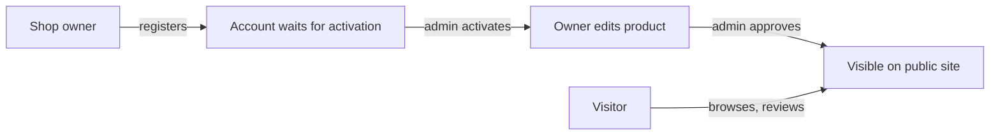

## Overview

Jehem Meadolan is a marketplace for small-business (UMKM) products from Desa Jehem in Bangli, Bali. Visitors browse products, read reviews, and contact the seller; shop owners manage their product from an admin panel, and village admins decide what goes public.

## Problem

The site serves two audiences with different needs: visitors who want a simple catalog of village products, and the people who decide what appears in it. Anyone can register as a shop owner, so new accounts and their products have to be checked before they are shown publicly.

## My Role

I built the site and the admin panel in Laravel: the public pages, the product and review flow, the role setup, and the Filament resources.

## Architecture

The public site (`/`, `/about`, `/contact`, `/detail-product/{id}`, `/register`) is server-rendered Blade with plain controllers. The admin panel lives at `/admin` and is built with Filament 3. A small JSON API under `/api/v1` serves paginated comments and registration.

## Tech Stack

- **Laravel 10** for routing, Eloquent models, migrations, and tests.
- **Filament 3.2** for the admin panel, so product, category, and user management did not need hand-built CRUD screens.
- **spatie/laravel-permission** for the `USER`, `ADMIN`, and `SUPER_ADMIN` roles.
- **Tailwind CSS with daisyUI** and **Splide** carousels on the public site, bundled with Vite.

## Key Features

- Three roles: shop owners manage one product, admins activate accounts, approve products, and manage categories, and super admins also create users and change roles.
- A product appears publicly only when it is both approved by an admin and active (a `published` query scope on the model).
- Products have categories, image attachments, seller contact links, and reviews with star ratings; the average rating uses an eager-loaded aggregate when available.
- Admin login with a phone number instead of an email, through a custom Filament login page.
- A daily visit counter with a per-month chart on the admin dashboard.
- Rate limits on registration (5 per minute) and on posting reviews (10 per minute).

## Challenges & Solutions

### Keeping unreviewed products off the public site

Visibility depends on two flags owned by two different people: the admin's approval and the owner's own on/off switch. Putting both in one `published` scope means every public query uses the same rule instead of repeating the two conditions in each controller.

### Logging in without email

Many shop owners use a phone number rather than an email address, so the Filament login form was replaced with one that authenticates by `phone_number`.

## Results

The repository includes feature tests for the public site, registration, product comments, and the admin panel, plus a unit test for the visit counter. They run against an in-memory SQLite database. Production setup steps (migrations, role seeding, and creating the first super admin from environment variables) are documented in the README.

## Links

- Repository: [NandaFebian/jehemweb-main](https://github.com/NandaFebian/jehemweb-main)
