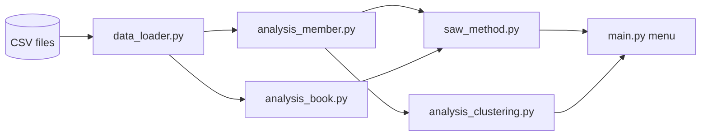

## Overview

A command-line decision support system for a library whose members are students. It reads loan and return records and answers two decisions with the Simple Additive Weighting (SAW) method, which members are the most valuable and which books should be restocked first, then groups members by behavior with K-Means clustering.

## Problem

A library's loan records already say who borrows often, who returns late, and which books run out. Turning that into a ranked list or a set of member groups needs a scoring method and a clustering method, and the goal here was to implement both directly rather than call a library.

## My Role

I wrote the whole project alone: the data loader, both algorithms, the analyses, the CLI menu, and a generator for test data.

## Architecture

Each analysis aggregates raw records into a decision matrix, and `saw_method.py` normalizes and scores any matrix given criteria types and weights, so both decisions reuse the same SAW code.

## Tech Stack

- **Python 3.8+ standard library only** (`csv`, `math`, `random`, `datetime`, `uuid`). No pandas, NumPy, or scikit-learn.

## Key Features

- Best members by SAW, from total borrows (benefit) and on-time return rate (benefit).
- Restocking priority by SAW, from loan count (benefit) and current stock (cost, so lower stock ranks higher).
- K-Means clustering of members by borrowing activity and on-time rate, with each cluster described from its centroid (for example high activity with high discipline).
- Most borrowed books, highly active members (more than 15 loans), and category preferences per student.
- A data generator that writes the CSV files (students, books, loans, returns), so the analyses can be run without real records.

## Challenges & Solutions

### Benefit and cost criteria in one score

SAW needs every criterion on the same scale and pointing the same way. Benefit criteria are normalized as `value / max` and cost criteria as `min / value`, so a higher normalized value is always better before the weights are applied.

### K-Means without a library

Borrow counts and on-time rates have different ranges, so borrow counts are rescaled to 0 to 100 before clustering to keep the Euclidean distance fair. Centroids start from random points, empty clusters are re-seeded, and iteration stops when centroids stop moving or after 20 rounds.

## Results

Both decisions and the clustering run from one menu on generated data. The data is synthetic, so the rankings show how the method works rather than findings about a real library.

## Links

- Repository: [NandaFebian/dss-book-library](https://github.com/NandaFebian/dss-book-library)
