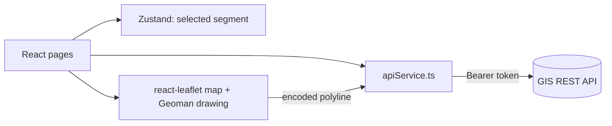

## Overview

A single-page app for managing road segment (ruas jalan) data on a map. Signed-in users see every segment drawn over Bali, pick one from a table to zoom to it, and add or edit segments by drawing the line directly on the map.

## Problem

Road data is geographic: a segment is a line on a map plus attributes such as length, width, surface, condition, and the village it belongs to. Editing that through a plain form would mean typing coordinates, so the app lets users draw the line and fills in the rest through forms.

## My Role

I built the frontend alone (all commits in the repository). The data comes from a provided GIS REST API (`gisapis.manpits.xyz`), which handles storage and authentication.

## Architecture

Routes are split into public (login, register) and protected pages. A Zustand store holds the segment selected in the table, and the map reacts to it by fitting its bounds to that segment. All API calls live in one service module that attaches the Bearer token.

## Tech Stack

- **React 19 with TypeScript**, built with **Vite**.
- **react-leaflet** for the map, **Leaflet-Geoman** for drawing and editing lines, and **@mapbox/polyline** to encode and decode segment paths.
- **Zustand** for the shared selected-segment state.
- **Tailwind CSS 4** with Radix-based UI components, and **axios** for HTTP.

## Key Features

- All road segments drawn on one map, which fits its view to the loaded data.
- Line style by road type (different dash patterns), so road types can be told apart on the map.
- Add and edit forms where the path comes from a line drawn on the map, plus length, width, existing surface, condition, road type, and notes.
- Cascading region selects: province, regency, district, then village, each loaded from the API.
- Segment table with search, filters by condition and road type, edit, and delete behind a confirmation dialog, with success and error alerts.

## Challenges & Solutions

### Storing a line as text

The API stores each segment's geometry as an encoded polyline string. The app decodes it with `@mapbox/polyline` to draw and fit bounds, and encodes the drawn Geoman line back into the same format before saving, so the map and the API share one representation.

## Results

A working client for creating, reading, updating, and deleting road segment data on top of the provided API, with drawing on the map, filtering in the table, and a table and map that stay in sync.

## Links

- Repository: [NandaFebian/gis-ts](https://github.com/NandaFebian/gis-ts)
