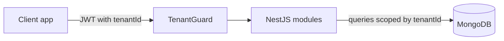

<Callout title="Placeholder content">
  This page is sample content for the portfolio layout. Replace each section with the real project details.
</Callout>

## Overview

A backend service that lets multiple organizations manage their own work orders in a single deployment, with each tenant's data isolated from the others.

## Problem

TODO: describe the situation before this project.

## My Role

TODO: describe what you owned.

## Architecture

TODO: describe the main modules and how tenant isolation works. Diagrams are written as Mermaid code blocks:



## Tech Stack

- **NestJS**: TODO: why it was chosen.
- **MongoDB**: TODO: why it was chosen.
- **TypeScript**: TODO: why it was chosen.

## Key Features

- TODO

## Challenges & Solutions

### Tenant isolation

TODO: explain the approach. Code samples render with syntax highlighting:

```ts title="tenant.guard.ts"
@Injectable()
export class TenantGuard implements CanActivate {
  canActivate(context: ExecutionContext): boolean {
    const request = context.switchToHttp().getRequest();
    return Boolean(request.user?.tenantId);
  }
}
```

## Results

TODO

## Links

TODO
