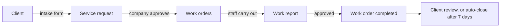

## Overview

A REST API for a work order portal, built as my undergraduate thesis. A company registers with its owner, invites staff into positions, and publishes services. Clients find a company, submit a service request through the service's intake form, and the company splits the request into work orders that staff carry out and report on.

## Problem

One request passes through several hands: the client describes the job, the company approves and plans it, staff do the work and report back. Each company asks different questions at each step, so forms cannot be hard-coded, and editing a form later must not change requests that already use it. Some companies want every step approved by a manager, others want steps to pass automatically.

## My Role

I designed and built the backend: data model, modules, authentication, role and position checks, background jobs, and the test and API documentation. The work lives on the repository's `dev` branch (281 commits).

## Architecture

Each domain is its own NestJS module: auth, company, positions, service, form, service request, work order, work report, membership, customer pairing, notifications, storage, and dashboard. Controllers are split by audience (for example `service-request.public.controller.ts` and `service-request.internal.controller.ts`), so a route's audience is visible from the file it lives in.

Requests carry a JWT Bearer token checked by a Passport strategy, which reloads the user with their company and position on every request. A roles guard then checks one of six roles: client, app admin, company owner, company manager, company staff, and unassigned staff.

## Tech Stack

- **NestJS 11**: modules, guards, interceptors, and DTO validation give each domain the same shape.
- **MongoDB with Mongoose**: forms are nested documents with variable fields, which fit a document store better than tables.
- **BullMQ**: queues for push notifications and delayed jobs.
- **Firebase Admin**: push notifications to client and staff devices through FCM.
- **S3-compatible storage with sharp**: uploaded images are converted to WebP before they are stored.
- **class-validator** with a global `ValidationPipe`, **bcrypt** for passwords, **@nestjs/throttler** at 60 requests per minute, and **Nodemailer** for OTP emails.

## Key Features

- Registration with email OTP verification, OTP resend with a cooldown, and a forgot-password flow.
- Company registration with an owner account, staff invitations and invitation codes, and positions (global defaults plus company-specific ones).
- Dynamic form templates with typed fields (text, number, date, single and multi select, checkbox, file, image) for intake, work order, and report forms.
- Approval rules per service: a step can pass automatically, or wait for a manager, the staff member in charge, or any staff member.
- Service requests, work orders, and work reports each with their own status flow, for example a work order moves through `drafted`, `sent`, `approved`, `on_progress`, and `completed` or `failed`.
- Customer pairing, which links a client's account on a company's own system so the portal can check their membership there.
- One response shape for success (interceptor) and one for errors, with validation errors flattened to field paths such as `fields[0].label`.

## Challenges & Solutions

### Editing a form without rewriting history

Form templates are versioned instead of updated in place. Every template has a stable `formKey`, and an edit inserts a new document with the same key and `__v + 1`. Editing an older version is refused, so two managers cannot fork the same form. A service request stores the IDs of the forms and the approval settings it was created with, so it keeps its original forms after the template changes.

### Closing requests nobody reviews

When a completed request needs a client review, the service queues a BullMQ job delayed by 7 days. If the request is still waiting when the job runs, the worker closes it and notifies the client through FCM. If the client reviewed it in time, the job finds nothing to close and stops.

### Auto-approval without skipped steps

When a work report's approval rule is automatic, submitting it approves the report and completes the parent work order in the same call. When approval is required, the work order must have a staff member in charge in the required position before it can move on.

## Results

The API covers the full path from company sign-up to a closed service request. The repository has 17 unit spec files and 16 end-to-end spec files (Jest and Supertest), a Postman collection, written test case tables for each module, and a Dockerfile. There is no public deployment, so no live demo is listed here.

## Links

- Repository: [NandaFebian/workorder-portal (dev branch)](https://github.com/NandaFebian/workorder-portal/tree/dev)
