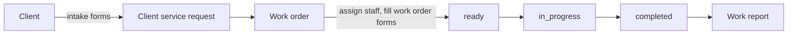

## Overview

A REST API for a work order portal. A company registers with its owner, invites employees into positions, and publishes services. Clients find a company, submit a service request through that service's intake forms, and the company turns the request into a work order that staff fill in, start, and complete.

## Problem

One request passes through several hands: the client describes the job, the company plans it, staff do it and report back. Each company on the portal asks different questions at each step, so the forms cannot be hard-coded, and editing a form later must not change work orders that already use it.

## My Role

I built the backend alone (all 62 commits in the repository): data model, modules, authentication, role checks, and the Vercel deployment entry point.

## Architecture

Each domain is its own NestJS module (auth, company, positions, service, form, client service request, work order, work report, membership, invitations). Controllers are split by audience, for example `services.client.controller.ts` for the public side and `services.internal.controller.ts` for company staff, so a route's audience is visible from the file it lives in.

Requests are authenticated with an opaque Bearer token: a UUID stored in an `ActiveToken` collection, so logging out deletes the token and it stops working at once. A roles guard then checks one of six roles: client, app admin, company owner, company manager, company staff, and unassigned staff.

## Tech Stack

- **NestJS 11**: modules, guards, interceptors, and DTO validation give each domain the same shape.
- **MongoDB with Mongoose**: forms are nested documents with variable fields, which fit a document store better than tables.
- **TypeScript**: shared DTOs and schemas between controllers and services.
- **class-validator** with a global `ValidationPipe`, **bcrypt** for passwords, **helmet**, and **Swagger** for API docs.

## Key Features

- Company registration with an owner account, employee invitations, and positions (global defaults plus company-specific ones).
- Services with required staff per position (minimum and maximum), access type (`public`, `member_only`, `internal`), and ordered intake, work order, and report forms.
- Dynamic form templates with typed fields, and per-form rules for which roles and positions may fill in or only view each form.
- Work order flow: `drafted`, then `ready` once every required work order form is submitted, then `in_progress` and `completed`, with `startedAt` and `completedAt` recorded.
- Membership codes: managers generate batches of codes with an optional prefix, users claim them, and a code can be claimed only once.
- One response shape for success (interceptor) and one for errors, including validation errors (exception filter).

## Challenges & Solutions

### Editing a form without rewriting history

Form templates are versioned instead of updated in place. Every template has a stable `formKey`, and an edit inserts a new document with the same key and `__v + 1`; reads pick the latest version by sorting on `__v`. When a work order is created, it stores a snapshot of each form (title, description, type, and access rules), so a work order keeps showing the form it was created with even after the template changes.

### Running NestJS on serverless

`api/index.ts` builds the Nest application once per cold start on top of an Express adapter and caches it, and `vercel.json` routes every path to that handler.

## Results

The API covers the full path from company sign-up to a completed work order with a report. The repository includes unit specs and end-to-end tests (`test/*.e2e-spec.ts`) run with Jest and Supertest. The Vercel deployment linked from the repository currently returns 404, so no live demo is listed here.

## Links

- Repository: [NandaFebian/workorder-portal](https://github.com/NandaFebian/workorder-portal)
